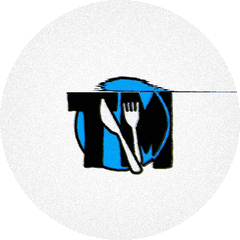

 
<a href="https://tmhsdigital.github.io/Github-Pages-Demo-1/">
<picture>
<source media="(prefers-color-scheme: dark)" srcset="assets/wordmark-dark.svg" />

</picture>
</a>

&nbsp;
&nbsp;

 
&nbsp;
&nbsp;
&nbsp;

<!-- TOP-REPOS:START -->

&nbsp;
&nbsp;

<!-- TOP-REPOS:END -->

## What I Build

- **Dev Tools** 
  Plugins and MCP servers for AI-assisted development, cataloged in [Developer-Tools-Directory](https://github.com/TMHSDigital/Developer-Tools-Directory), including [Docker](https://github.com/TMHSDigital/Docker-Developer-Tools), [Steam](https://github.com/TMHSDigital/Steam-Cursor-Plugin) (with [steam-mcp](https://github.com/TMHSDigital/steam-mcp)), [Unity](https://github.com/TMHSDigital/Unity-Developer-Tools), [FiveM/RedM](https://github.com/TMHSDigital/CFX-Developer-Tools), [Mobile](https://github.com/TMHSDigital/Mobile-App-Developer-Tools), [Blender](https://github.com/TMHSDigital/Blender-Developer-Tools) and [screencast-mcp](https://github.com/TMHSDigital/screencast-mcp).

- **Games** 
  [*System.Execute*](https://store.steampowered.com/app/4353080) is live on Steam, an Electron app with full Steamworks SDK integration. Coming 2027: [*Slap Boxing Simulator*](https://store.steampowered.com/app/5081390/Slap_Boxing_Simulator/), wishlist it on Steam. Free in the browser: [GH-Arcade](https://github.com/TMHSDigital/GH-Arcade), a neon arcade built with Phaser 3, plus [Static_Chess](https://github.com/TMHSDigital/Static_Chess) and [Typing-Game](https://github.com/TMHSDigital/Typing-Game).

- **Security & Utilities** 
  [subenum](https://github.com/TMHSDigital/subenum) - fast, concurrent subdomain enumeration with wildcard filtering and a TUI, shipped as a single Go binary. [Kali-Linux-for-beginners](https://github.com/TMHSDigital/Kali-Linux-for-beginners) - a free, hands-on ethical-hacking course with a Dockerized practice lab. [autoclicker](https://github.com/TMHSDigital/autoclicker) - a free Windows auto clicker with image matching and safety stops, shipped as a single .exe.

- **Homelab** 
  Raspberry Pi 5 running 15+ self-hosted services, managed entirely from Windows with Ansible and Docker. Tooling: [Home-Lab-Developer-Tools](https://github.com/TMHSDigital/Home-Lab-Developer-Tools).

- **Resources** 
  [Free-Game-Dev-Assets](https://github.com/TMHSDigital/Free-Game-Dev-Assets) - a catalog of free, commercially usable game assets with each licence recorded from its source. [Awesome-Ads](https://github.com/TMHSDigital/Awesome-Ads) - an advertising playbook for small businesses.

- **Hospitality Strategy** 
  Through [TM Hospitality Strategies](https://tmhsdigital.github.io/Github-Pages-Demo-1/) I work with restaurants, hotels, cafés, bars and caterers on concept and positioning, menu engineering, labor and scheduling, cost control and new openings.

## Tech

## Metrics & Activity

<b>[ View Dashboard ]</b>

 

<table>
<tr>
<td align="center" valign="middle">
<picture>
<source media="(prefers-color-scheme: dark)" srcset="https://raw.githubusercontent.com/TMHSDigital/TMHSDigital/output/stats-dark.svg" />

</picture>
</td>
<td align="center" valign="middle">
<picture>
<source media="(prefers-color-scheme: dark)" srcset="https://raw.githubusercontent.com/TMHSDigital/TMHSDigital/output/top-langs-dark.svg" />

</picture>
</td>
</tr>
</table>

  
<picture>
<source media="(prefers-color-scheme: dark)" srcset="https://raw.githubusercontent.com/TMHSDigital/TMHSDigital/output/github-contribution-grid-snake-dark.svg" />

</picture>

Running a restaurant or hospitality business? <a href="https://tmhsdigital.github.io/Github-Pages-Demo-1/#contact">Start a conversation</a>. If my open-source work is useful to you, you can <a href="https://github.com/sponsors/TMHSDigital">sponsor it on GitHub</a>.

---
