 
<a href="https://tmhsdigital.github.io/Github-Pages-Demo-1/">
<picture>
<source media="(prefers-color-scheme: dark)" srcset="assets/wordmark-dark.svg" />

</picture>
</a>
  
<table align="center"><tr><td align="center">
&nbsp;
&nbsp;

 
&nbsp;
&nbsp;
&nbsp;

</td></tr></table>
<!-- TOP-REPOS:START -->
<table align="center"><tr><td align="center">
<picture><source media="(prefers-color-scheme: dark)" srcset="assets/label-top-projects-dark.svg" /></picture>
 
&nbsp;
&nbsp;

</td></tr></table>
<!-- TOP-REPOS:END -->

 

<table align="center"><tr><td align="center">
<picture><source media="(prefers-color-scheme: dark)" srcset="assets/label-building-dark.svg" /></picture>

<b>[ View Projects ]</b>

 

- **Dev Tools:** 17 plugins and MCP servers in the [Developer-Tools-Directory](https://github.com/TMHSDigital/Developer-Tools-Directory), including [Blender](https://github.com/TMHSDigital/Blender-Developer-Tools), [Unity](https://github.com/TMHSDigital/Unity-Developer-Tools), [Docker](https://github.com/TMHSDigital/Docker-Developer-Tools), [Steam](https://github.com/TMHSDigital/Steam-Cursor-Plugin), [steam-mcp](https://github.com/TMHSDigital/steam-mcp), [FiveM/RedM](https://github.com/TMHSDigital/CFX-Developer-Tools), [Mobile](https://github.com/TMHSDigital/Mobile-App-Developer-Tools) and [screencast-mcp](https://github.com/TMHSDigital/screencast-mcp)
- **Games:** [*System.Execute*](https://store.steampowered.com/app/4353080) on Steam · [*Slap Boxing Simulator*](https://store.steampowered.com/app/5081390/Slap_Boxing_Simulator/) coming 2027 · [GH-Arcade](https://github.com/TMHSDigital/GH-Arcade), [Static_Chess](https://github.com/TMHSDigital/Static_Chess) and [Typing-Game](https://github.com/TMHSDigital/Typing-Game) in the browser
- **Security & Utilities:** [subenum](https://github.com/TMHSDigital/subenum) Go subdomain enumerator · [Kali-Linux-for-beginners](https://github.com/TMHSDigital/Kali-Linux-for-beginners) ethical-hacking course · [autoclicker](https://github.com/TMHSDigital/autoclicker) Windows auto clicker
- **Homelab:** Raspberry Pi 5 with 15+ self-hosted services, run with Ansible and Docker · [Home-Lab-Developer-Tools](https://github.com/TMHSDigital/Home-Lab-Developer-Tools)
- **Resources:** [Free-Game-Dev-Assets](https://github.com/TMHSDigital/Free-Game-Dev-Assets) licence-checked game assets · [Awesome-Ads](https://github.com/TMHSDigital/Awesome-Ads) ad playbook for small businesses
- **Hospitality:** [TM Hospitality Strategies](https://tmhsdigital.github.io/Github-Pages-Demo-1/) menu engineering, labor, cost control and openings for restaurants and hotels

</td></tr></table>
<table align="center"><tr><td align="center">
<picture><source media="(prefers-color-scheme: dark)" srcset="assets/label-tech-stack-dark.svg" /></picture>

<b>[ View Stack ]</b>

 

 

 

 

 

</td></tr></table>

<table align="center"><tr><td align="center">
<picture><source media="(prefers-color-scheme: dark)" srcset="assets/label-metrics-dark.svg" /></picture>

<b>[ View Dashboard ]</b>

 

<picture>
<source media="(prefers-color-scheme: dark)" srcset="https://raw.githubusercontent.com/TMHSDigital/TMHSDigital/output/streak-dark.svg" />

</picture>
  
<picture>
<source media="(prefers-color-scheme: dark)" srcset="https://raw.githubusercontent.com/TMHSDigital/TMHSDigital/output/overview-dark.svg" />

</picture>
  
<picture>
<source media="(prefers-color-scheme: dark)" srcset="https://raw.githubusercontent.com/TMHSDigital/TMHSDigital/output/activity-dark.svg" />

</picture>
  
<picture>
<source media="(prefers-color-scheme: dark)" srcset="https://raw.githubusercontent.com/TMHSDigital/TMHSDigital/output/github-contribution-grid-snake-dark.svg" />

</picture>

</td></tr></table>

Running a restaurant or hospitality business? <a href="https://tmhsdigital.github.io/Github-Pages-Demo-1/#contact">Start a conversation</a>. If my open-source work is useful to you, you can <a href="https://github.com/sponsors/TMHSDigital">sponsor it on GitHub</a>.

---
